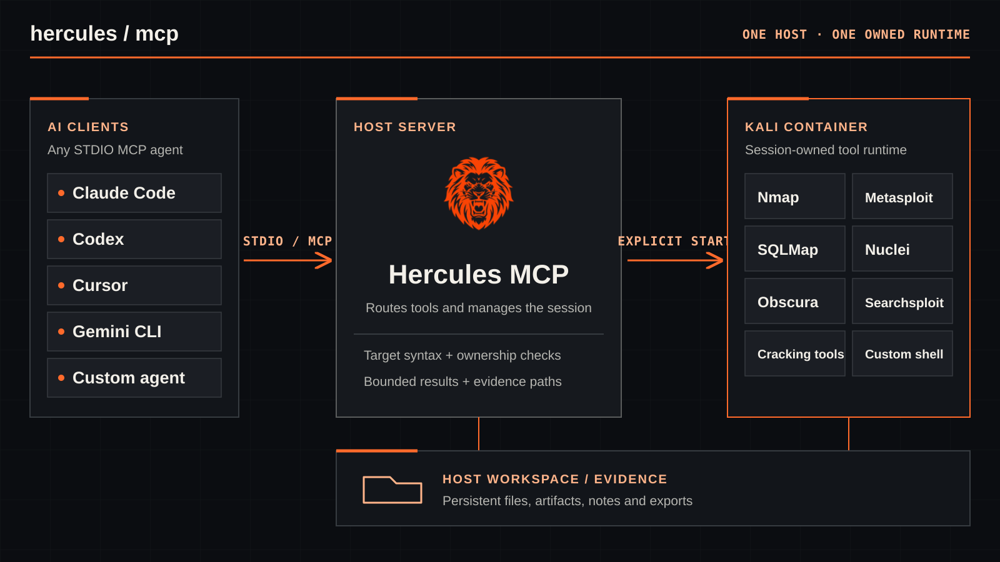

<p align="center">
  
</p>

<h1 align="center">Hercules MCP</h1>

<p align="center">
  <em>Containerized offensive-security workflows for AI agents through the Model Context Protocol</em>
</p>

<p align="center">
  
  
  
  
</p>

Hercules MCP is a Python FastMCP server that gives terminal-capable AI agents a
structured interface to security tools running in an owned Kali Docker
container. It keeps evidence in managed host workspaces and returns bounded,
agent-friendly results without hiding whether output was filtered, truncated,
or interrupted.

[Explore the Hercules showcase](https://0xmihirk.github.io/hercules-mcp/) for an
interactive introduction to the workflow, tools, and workspace evidence.

> **Authorized use only.** Run Hercules only against systems for which you have
> explicit permission. Installation and verification are local and
> non-destructive; they must not scan, exploit, navigate to, or check public
> egress against an external target.

<p align="center">
  
</p>

## Contents

- [Install with your AI agent](#install-with-your-ai-agent)
- [Capabilities and MCP surface](#capabilities-and-mcp-surface)
- [How Hercules works](#how-hercules-works)
- [Headless browser automation](#headless-browser-automation)
- [Output, artifacts, sessions, and workspaces](#output-artifacts-sessions-and-workspaces)
- [MCP resources and agent guidance](#mcp-resources-and-agent-guidance)
- [Setup facts and client configuration](#setup-facts-and-client-configuration)
- [Troubleshooting](#troubleshooting)
- [Development](#development)
- [Security model](#security-model)
- [Acknowledgements](#acknowledgements)
- [License](#license)
- [Support](#support)

## Install with your AI agent

Paste this prompt unchanged into any terminal-capable coding agent. The same
prompt adapts to Windows, macOS, and capable Linux distributions:

```text
Install or update Hercules MCP using https://github.com/0xMihirK/hercules-mcp/blob/main/install.md. Configure only this agent. Host install needs no container; if a container step is denied, stop and tell me how to approve it. Report the result.
```

The shared [setup workflow](install.md) handles discovery, install/update,
repair, and recovery. `status` is read-only; `install` prepares a permanent
version and registers an absolute launcher for just the selected client.
Repeated installation preserves your configuration without asking you to
choose update versus reinstall. An explicit `--reinstall` remains available.

Host setup needs Git and [`uv`](https://docs.astral.sh/uv/), but not Docker.
Use `scripts/setup.ps1` on Windows or `scripts/setup.sh` on macOS/Linux to
bootstrap once, then reuse the absolute `hercules-setup` launcher. Supported
clients include Claude Code/Desktop, Codex, Cursor, VS Code, Gemini CLI,
OpenCode, Windsurf, and Hermes; other local STDIO clients can use a generic export.

`runtime prepare` separately reuses/pulls a verified release image and provisions verified
assets. `verify` checks cold STDIO; `verify --runtime` explicitly tests a local
container. New installs default to full capabilities; existing selections,
secrets, workspaces, assets, scope, and unrelated settings are preserved.
An update needing a new image stays pending while the old version remains active.
Running environments are never moved or replaced, and no broad cleanup is used.

For Claude Code auto mode, a denied action stays stopped until you resolve it
through Claude's permission interface. Setup does not change permission modes
or approval rules. Missing privileged prerequisites also require operator action.

## Capabilities and MCP surface

One full Kali image contains every tool bundle; there is no lean image.
The confirmed capability set controls MCP visibility, not physical package
removal. Core shell, session, and workspace services are mandatory. Setup facts
report installed and exposed capabilities separately.

| Profile | Registered tools | Resources |
| --- | ---: | ---: |
| Full, including Metasploit | 47 | 5 |
| Full, with `SKIP_METASPLOIT=true` | 42 | 5 |
| Custom selection | Fewer, according to selected and hidden tools | 5 |

The catalog groups these stable capability keys:

| Area | Capability keys | Functionality |
| --- | --- | --- |
| Core | `shell`, `session`, `workspace` | Commands, jobs, lifecycle, network information, and binary-safe files |
| Reconnaissance | `dns`, `whois`, `amass` | DNS/WHOIS queries and subdomain or ASN enumeration |
| Network | `nmap`, `curl`, `ncat`, `hping3` | Port/service/NSE scanning, HTTP, sockets, listeners, and packet crafting |
| Web | `whatweb`, `fuzz`, `webvuln`, `nuclei`, `sqlmap` | Fingerprinting, discovery, vulnerability checks, templates, and SQL injection workflows |
| Exploitation | `searchsploit`, `metasploit` | Exploit-DB, modules, sessions, listeners, and payloads |
| Passwords | `hydra`, `john` | Authorized online testing and offline hash cracking |
| Forensics/CTF | `binwalk`, `steghide` | Carving, metadata, and steganography |
| Browser | `browser` | All ten structured browser tools, screenshots, sessions, and loopback streaming |

Bundles keep consolidated APIs intact: Nmap includes NSE authoring, Nuclei
includes template authoring, and browser includes every `browser_*` tool.
SecLists and rockyou are required only by profiles that use them.
`HERCULES_DISABLED_TOOLS` can independently hide an installed tool, but it
does not remove its binary from the full image.

Capability selection controls tool visibility, not a sandbox against the
privileged container shell. After explicit startup, agents may deliberately
install/use custom tools through `shell_exec`; keep scripts, dependency notes,
and Python virtual environments under `/opt/workspace`. Container-layer installs
are temporary and are never replayed automatically. The small baseline includes
SSH, jq, unzip, and Python virtual-environment support. The separately locked
Python toolbox is available as `/opt/hercules-python/bin/python` (HTTP clients,
WebSockets, JWT, cryptography, Paramiko, Pillow, and flask-unsign); system Python
and distro tools are not replaced.

## How Hercules works

1. The MCP client starts the absolute `hercules` STDIO launcher.
2. Hercules exposes tool and resource schemas immediately without creating a
   Docker container.
3. The agent calls `system_start_container` immediately before its first
   Docker-backed operation. Repeated calls reuse the same container.
4. A typed MCP call is validated and routed to a generation-bound service.
5. The command runs inside the owned, full Kali container.
6. Results are parsed and bounded while complete evidence is retained in the
   workspace when necessary.

Before explicit startup, Docker-backed tools return `runtime_not_started` with
instructions to call `system_start_container`; they never start Docker
implicitly. After explicit startup, unexpected container failures retain the
existing same-workspace recovery behavior. Hercules reclaims only containers
proven stale by exact owner PID and creation time, project identity, and
workspace identity; unrelated or live instances are preserved.

Each session has an eight-character hexadecimal ID and an owned manifest.
Container replacement resets browser daemons, Metasploit clients, channels,
jobs, and other generation-bound state while preserving host evidence. An
operator-requested stop stays terminal until `system_start_container` is called.
`system_start_new_session` creates a clean workspace and leaves it stopped.

Use related challenge folders or choose an isolated workspace when necessary;
coordinate parallel workers before rotation or shutdown. There is no idle
auto-stop. At completion/abandonment, save progress, resolve owned jobs, stop the
current runtime, and check its `cleanup` confirmation. Report preserved stopped
containers and unverified cleanup separately; never prune another live owner.

Hercules imposes no configurable target allow/block list — you are responsible for
staying within the authorized scope. Structured tools validate a target for syntax
only, and the browser has **no SSRF boundary**: on host networking it can reach
host-local, the LAN, and cloud-metadata (`169.254.169.254`) services, so only browse
explicitly authorized targets.

## Headless browser automation

The full image combines
[agent-browser](https://github.com/vercel-labs/agent-browser) with
[Obscura](https://docs.obscura.sh/), pinned at **0.39.1** and **0.2.5** respectively.
Native rendering/stealth artifacts and matching controller skill documentation
are checksum-verified; no npm runtime or managed Chromium download is required.

**Obscura does not enforce CSP.** JavaScript execution is not proof of a CSP
bypass in Chromium. Every browser response advertises this limitation. This
experimental backend has incomplete browser fidelity, storage-state support,
and no native downloads. Unsupported operations fail explicitly; there is no
automatic alternate engine.

The controller's domain allowlist is not a security boundary, and on host networking
there is **no SSRF boundary at all** — the browser can reach host-local, the LAN, and
cloud-metadata (`169.254.169.254`) services. The engine still runs unprivileged, but
you are responsible for only browsing authorized targets. This candidate remains under
release verification; keep the working installation until acceptance passes. Privileged
shell commands are likewise unconfined.

- Sessions always run headlessly; screenshots and loopback live streaming
  remain available.
- `browser_screenshot` validates PNG bytes and returns native MCP
  `ImageContent`, with optional annotations and compatibility base64 metadata.
- Proxy precedence is `browser_open(proxy=...)`, then `BROWSER_PROXY_URL`, then
  direct gateway egress. HTTP(S) CONNECT and locally resolved SOCKS5 upstream
  proxies are supported; unverifiable remote-DNS proxy modes are rejected. Credentials
  are redacted from responses and logs. Proxy bypass rules/custom browser CAs
  are unsupported; TLS verification is never implicitly disabled.
- Tracker filtering is disabled so target resources are not silently omitted.
- Proxy/timezone/scope changes relaunch that session transactionally. Explicit
  per-session locale and fingerprint selection are rejected, not ignored.
- On host networking, container `localhost` is the host, and the browser (no SSRF
  boundary) can reach host-local, the LAN, and cloud-metadata services. A remote
  Docker context refers to the remote engine, not this computer.

Docker does not provide residential or ISP egress; direct container traffic
normally shares the host's public IP. Obscura reduces some automation
signals, but Hercules cannot guarantee CAPTCHA or bot-detection avoidance.

Use structured browser tools first. `browser_cmd` is an administrator escape
hatch for supported advanced controller operations and sits outside structured
target guarantees. Load `browser_skill` before using it.

For direct files use existing HTTP/shell tools, save bytes beneath
`/opt/workspace`, and verify size/checksum. Authenticated requests require
deliberate, private handling of the necessary cookies/headers; they are never
automatically replayed. Browser-generated/blob/native downloads are not
guaranteed and must not be reported successful without a verified file.

Runtime preparation defaults to `--image-source auto`: a validated local cache,
then the published digest pulled from **GHCR** (`ghcr.io/0xmihirk/hercules-mcp`),
falling back to the identical-digest **Docker Hub** mirror (`0xmihirk/hercules-mcp`).
To build the full image locally from source instead — **slower**, for an unreleased
checkout, custom build trust, or an offline host — use
`runtime prepare --client <client> --image-source build --yes` explicitly.
`--image-source prebuilt` only pulls, never builds; `auto` never silently builds
after a registry failure, and no release digest is invented when a revision has
no published image. Existing installations remain active while a replacement is
pending.

## Output, artifacts, sessions, and workspaces

Hercules optimizes output for agents without treating discarded text as
evidence:

- terminal controls and exact known banners are removed conservatively;
- scanner-specific compaction affects only characterized stdout noise;
- stderr warnings, errors, tracebacks, and completeness diagnostics remain;
- streams and combined responses have bounded inline budgets;
- timeouts report truthful termination and partial-output state; and
- structured Nmap, Nuclei, ffuf, httpx, and browser results replace duplicated
  raw text when parsing succeeds.

`output_complete` describes inline output. `evidence_complete` says whether
complete raw evidence remains inline or in a verified artifact. Large workspace
reads support `offset` and `max_bytes` paging.

Workspace paths reject traversal, alternate drives, device paths, and symlink
or reparse-point escapes. Evidence retention is disabled by default; non-empty
evidence is never silently deleted. `hercules-workspace` exposes list, pin,
unpin, prune, migrate, retire, and explicit regular-file import/export operations. Pruning is report-only without `--apply`
and protects active, pinned, unowned, and running-job sessions. Migration stages
and verifies the copy, cuts over explicitly selected client registrations and
their effective dotenv, and always retains the source. Close all source MCP
connections first, including cold ones. Source retirement is a separate explicit
operation that rechecks references and evidence; see the workspace guide below.

`workspace_inspect` lists, stats, and page-reads current or retained owned files
without starting Docker. Lifecycle responses distinguish `host_workspace` from
`container_workspace`; native host tools cannot read `/opt/workspace` directly.
Retained evidence is not mounted in the current container. Explicit transfers
verify SHA-256 and refuse existing destinations without `--overwrite`; see the
portable [workspace guide](skills/hercules-mcp/references/workspace-and-evidence.md).

## MCP resources and agent guidance

The plugin ships nine portable skills. Setup installs them for the selected
client independently of native plugin adapters:

- [Hercules MCP](skills/hercules-mcp/SKILL.md) covers the everyday tool and workspace workflow.
- [Operator](skills/hercules-operator/SKILL.md) helps choose tools, coordinate workers, verify evidence, and finish cleanup.
- [Nmap NSE](skills/hercules-nmap-nse/SKILL.md) and [Nuclei](skills/hercules-nuclei/SKILL.md) cover script and template authoring.
- [Application testing](skills/hercules-application-testing/SKILL.md), [infrastructure](skills/hercules-infrastructure/SKILL.md), [wireless and embedded](skills/hercules-wireless-embedded/SKILL.md), [binary analysis](skills/hercules-binary-analysis/SKILL.md), and [assessment operations](skills/hercules-assessment-operations/SKILL.md) route to focused testing guidance.

The operator and domain skills link to 79 topic references; open only the one
relevant to the task. Skills do not add MCP tools, start Docker, or authorize
high-impact actions. The MCP tool and resource surface is unchanged.

Hercules exposes five resources and two optional exact-name lookup templates.
The former `resource://agent_skills/nse` and
`resource://agent_skills/nuclei` handbook URIs are no longer registered; load
the corresponding bundled skills instead.

| Resource | Use it when |
| --- | --- |
| `resource://post_exploitation/linpeas` | An authorized Linux shell needs broad local enumeration; this is an embedded lite variant |
| `resource://post_exploitation/winpeas` | An authorized Windows command shell needs broad local enumeration |
| `resource://post_exploitation/powerup` | An authorized PowerShell shell needs service or registry follow-up |
| `resource://post_exploitation/gtfobins` | Linux evidence identifies an exact sudo, SUID, or capability-enabled binary |
| `resource://post_exploitation/lolbas` | Windows evidence identifies an exact signed binary, script, library, or component |

For a known binary, read `resource://post_exploitation/gtfobins/{name}` or
`resource://post_exploitation/lolbas/{name}` with its URL-encoded executable name
to avoid loading the full catalog. Clients without resource-template support may
continue reading the full resource.

Prefer installed NSE scripts and Nuclei templates before authoring custom
content. Do not load large post-exploitation resources speculatively.
Enumeration findings are evidence to verify, not permission to exploit.

## Setup facts and client configuration

`hercules --setup-info-json` is a strictly read-only information surface for
installation agents. Optional selectors let an agent normalize a capability
profile, inspect an existing non-secret state file, describe an approved custom
CA bundle, or inspect legacy browser settings without activating them. Its
JSON reports:

- catalog, normalized selection, required binaries, wordlists, and MCP counts;
- source revision, Python lock identity, and absolute-launcher requirements;
- stable Kali base, APT suite, platform, image tag, labels, and build inputs;
- capability-manifest checksum and runtime evidence paths;
- pinned Obscura/controller artifacts, hashes, explicit limitations, and inactive legacy browser facts;
- optional certificate-only BuildKit secret metadata and fingerprint;
- non-secret environment requirements and schema-4 state locations; and
- local acceptance assertions.

The mode does not build, download, install, write, modify `PATH`, register a
client, or update Docker. `hercules-setup` consumes these facts to implement
the shared workflow in [install.md](install.md).

Repository MCP files are templates and must be rendered before installation;
their bare `hercules` command is never a finished registration. An effective
MCP entry needs an absolute launcher, no secrets, and the client's native
120000 millisecond local-STDIO startup timeout when supported. Its exact JSON,
JSONC, TOML, or CLI representation depends on the installed client:

```json
{
  "mcpServers": {
    "hercules": {
      "command": "<absolute path to the managed hercules launcher>",
      "args": []
    }
  }
}
```

The agent must preserve unrelated configuration and validate the client's
effective entry, and it configures only the active client. For OpenCode it also
honors `OPENCODE_CONFIG` and XDG paths,
preserves JSONC comments, supports the installed client's direct or nested MCP
layout, uses its current local-command form with an absolute command array and
`timeout: 120000`, and places the independent skill at
its own OpenCode skills directory. Shared directories recorded for another
client are not silently overwritten.

Multiple coding agents and IDEs may connect at the same time. Hercules assigns
each live STDIO server a separate workspace session but creates no container
until that session calls `system_start_container`. Active containers receive a
collision-free runtime port set. Agents must call `system_network_info` after
startup in their own MCP session before choosing callback or listener ports.

If an IDE force-terminates its STDIO child, a detached guardian verifies the
exact owner process identity and full Hercules labels before removing only that
client's container. Normal shutdown still performs synchronous cleanup; no
broad Docker pruning is used.

Runtime values remain in the protected `.env`. See
[the complete template](.env.example). The most operational settings are:

| Variable | Purpose |
| --- | --- |
| `HERCULES_ENV_FILE` | Absolute dotenv path for shared configuration outside version directories; defaults to checkout `.env` |
| `HERCULES_INSTALLED_CAPABILITIES` | Agent-maintained capability selection |
| `HERCULES_DISABLED_TOOLS` | Independently hide an installed MCP tool |
| `HERCULES_WORKSPACE_ROOT` | Override the managed evidence root |
| `HERCULES_WORDLIST_ROOT` | Reusable verified wordlist and extraction cache |
| `HERCULES_BUILD_CA_SHA256` | Fingerprint of optional certificate-only build trust |
| `HERCULES_IMAGE_PLATFORM` | Exact `linux/amd64` or `linux/arm64` runtime platform |
| `HERCULES_CLOAKBROWSER_*` | Deprecated compatibility fields; do not select the active Obscura backend |
| `HERCULES_LISTENER_PORTS` | Explicit reverse-listener ports (bound directly on the host under host networking) |
| `MSF_RPC_PORT` | Loopback-only Metasploit RPC port (default `15553`) |
| `HERCULES_AUTO_ALLOCATE_PORTS` | Select a collision-free runtime port set for concurrent clients (default `true`) |
| `BROWSER_PROXY_URL` | Default browser proxy kept outside client configuration |
| `BROWSER_STREAM_PORT` | Optional loopback-only browser stream port |
| `SKIP_METASPLOIT` | Omit the five Metasploit tools from an installed full profile |

## Troubleshooting

Ask the active agent to compare current state with the read-only setup facts and
image capability manifest before deleting or rebuilding anything. It should
distinguish missing Git, `uv`, or Docker; a stopped or incompatible daemon; TLS
trust failure; unverified image identity; missing backend or asset; unsupported
Obscura option; MCP startup failure; and client-registration failure.
An unchanged package, checksum, or build-command failure is deterministic, not
a reason for another blind retry or silently removing a capability. A registry
EOF, connection reset, timeout, or retryable 5xx while pulling the pinned base
may receive at most two bounded retries with unchanged image identity. The
Docker producer's exit status must remain authoritative even when output is also
sent to a logger such as `tee`.

Agents must never print or dump `.env` to validate it. Read-only setup facts
report only whether secrets are configured and persisted. Any exposed secret is
rotated before acceptance without displaying its replacement.

The pinned public CA bootstrap remains present before Kali's first HTTPS APT
operation. In an authorized TLS-interception environment, the agent can pass a
bounded certificate-only PEM as a BuildKit secret and record only its SHA-256.
Certificate/hostname verification must never be disabled, and certificate
contents must not enter the checkout or state.

Failed work must restore the last committed Hercules client entry and
non-secret state. Checksum-valid downloads and immutable Docker cache may be
reused. Existing workspaces, evidence, secrets, successful images, and unrelated
client configuration must remain untouched.

## Development

Key areas are:

```text
hercules/
|-- main.py                  # FastMCP entrypoint and read-only setup mode
|-- core/                    # Configuration, setup facts, workspaces, lifecycle, execution, jobs
|-- output/                  # Rendering, filters, redaction, and truncation
|-- tools/                   # Structured MCP tools, including browser operations
`-- resources/               # MCP resources and embedded lite scripts
skills/                     # General and focused portable plugin skills
docker/entrypoint.sh         # Container readiness and loopback-only services
Dockerfile                   # Full Kali/Obscura runtime with locked browser/toolbox assets
install.md                   # Shared setup CLI workflow and recovery guide
```

Before submitting changes, compile the package, run the unit suite, validate
setup facts and package contents, and check the Git diff for whitespace errors.
Vulnerable fixtures, acceptance evidence, `.env`, workspaces, wordlists, and
distributions are local-only. The wheel and source distribution exclude tests.

## Security model

- The Kali container runs powerful root-level security tooling. Docker is a
  containment boundary, not a substitute for authorization or host hardening.
- Metasploit RPC and browser-stream ports bind to host loopback. Explicitly
  configured reverse-listener ports remain externally reachable.
- Secrets, cookies, tokens, form values, and proxy credentials are redacted
  from display metadata while invoked processes still receive original values.
- `shell_exec`, `browser_cmd`, and documented raw `extra_args` fields are
  trusted administrator escape hatches outside structured target guarantees.
- There is no configurable target allow/block list or browser SSRF boundary on
  host networking. Browser traffic can reach host-local, LAN, and metadata
  services; you are responsible for browsing only authorized targets.
- `pymetasploit3` remains pinned despite
  [GHSA-qpc3-8vqg-8g6w](https://osv.dev/vulnerability/GHSA-qpc3-8vqg-8g6w)
  because no fixed release exists. Hercules does not call the affected API and
  rejects CR/LF in Metasploit option keys and values.

## Acknowledgements

Hercules builds on
[Kali Linux](https://www.kali.org/),
[FastMCP](https://github.com/jlowin/fastmcp),
[Metasploit Framework](https://www.metasploit.com/),
[ProjectDiscovery](https://projectdiscovery.io/),
[SecLists](https://github.com/danielmiessler/SecLists),
[agent-browser](https://github.com/vercel-labs/agent-browser), and
[Obscura](https://github.com/h4ckf0r0day/obscura). Thank you to their
maintainers and contributors.

## License

Hercules MCP is distributed under the [MIT License](LICENSE).

## Support

If Hercules has helped your work, [buy me a beer](https://buymeacoffee.com/mihirkatoch)
to support its continued development.
