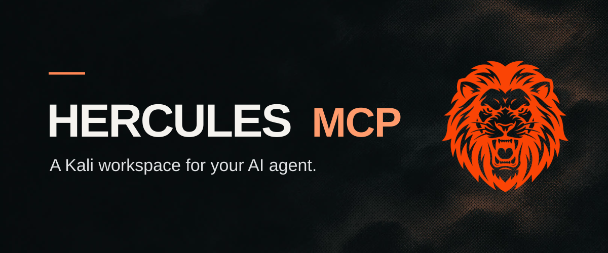
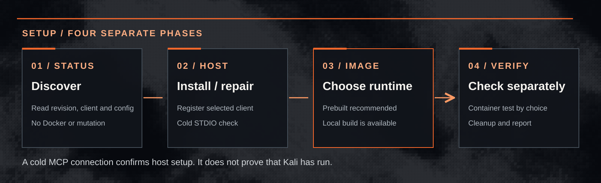
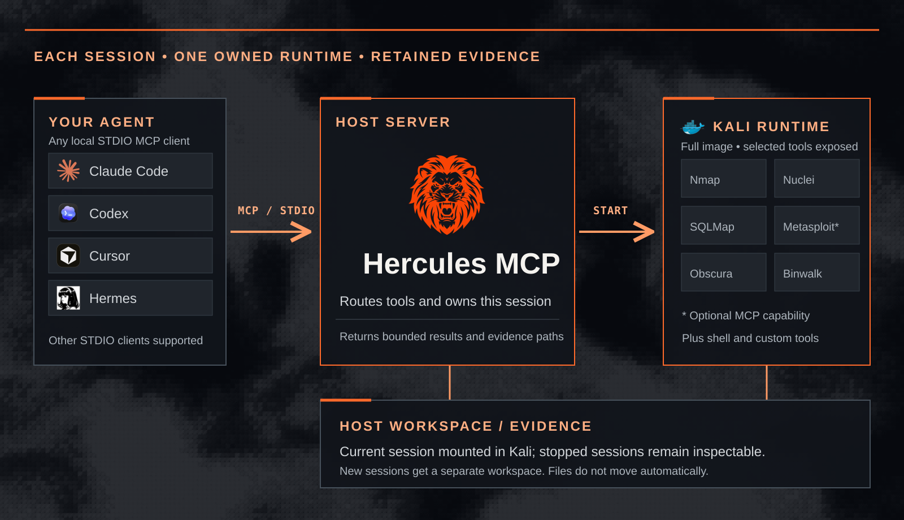
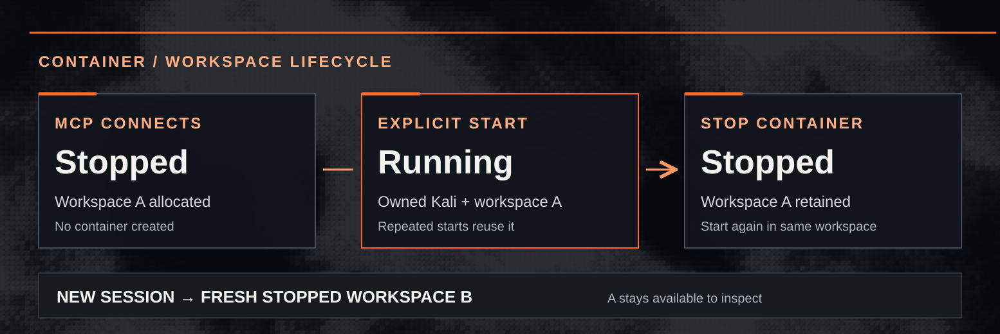

<h1 align="center">Hercules MCP</h1>
<p align="center"><strong>A Kali workspace for your AI agent.</strong></p>
<p align="center"><a href="https://0xmihirk.github.io/hercules-mcp/">Website</a> · <a href="install.md">Install</a> · <a href="GUIDE.md">Guide</a> · <a href="https://github.com/0xMihirK/hercules-mcp/stargazers">Star the repo</a></p>

<p align="center">
  <a href="GUIDE.md#capabilities-and-mcp-surface"></a>
  <a href="GUIDE.md#capabilities-and-mcp-surface"></a>
  <a href="GUIDE.md#mcp-resources-and-agent-guidance"></a>
  <a href="GUIDE.md#mcp-resources-and-agent-guidance"></a>
  <a href="install.md"></a>
  <a href="LICENSE"></a>
</p>

Hercules gives terminal-capable AI agents structured MCP access to security tools and Obscura browser automation. An agent starts its own Kali container **only when needed**. Results and evidence stay in a session-owned workspace on your host.

**Use cases:** authorized penetration testing · CTF and forensics · vulnerability research · browser automation · basic binary and firmware triage.

> **Authorized use only.** Use Hercules only on systems you are permitted to test. The full Kali image and privileged shell do not grant target authorization.

## Install with your AI agent

Paste this prompt into the terminal-capable agent you want to configure:

```text
Install or update Hercules MCP via https://github.com/0xMihirK/hercules-mcp/blob/main/install.md. Configure only this agent. Host setup does not start containers. Ask: prebuilt image (recommended) or local build. Prepare runtime after my choice. Stop and report denials.
```

The [installation guide](install.md) covers supported clients, Windows/macOS/Linux bootstrap commands, updates, repair, and recovery. Host setup needs Git and uv; it does not start Docker. Your agent asks you to choose a pinned **prebuilt Kali image (recommended)** or a local build before runtime preparation. Container verification is separate. Updates preserve client settings and evidence, and keep the working version active until a replacement is ready.

**Clients:** Claude Code/Desktop, Codex, Cursor, VS Code, Gemini CLI, OpenCode, Windsurf, Hermes, and other local STDIO MCP clients through a generic export.

[](assets/setup-flow-v2.svg)

## How it works

Your agent connects to the Hercules host server over STDIO. The connection exposes tools and resources **without creating a container**. `system_start_container` explicitly starts or reuses the session-owned Kali runtime; the current host workspace is mounted there so evidence survives a stop.

[](assets/architecture-v4.svg)

## Tools and capabilities

One full image contains all tool bundles. Capability settings control which MCP tools an agent sees; they do not remove packages from the image. The full profile has **47 tools, 5 resources, and 2 lookup templates**. With Metasploit disabled it has 42 tools; core-only has 12.

| Area | What the agent can use |
| --- | --- |
| **Session, shell and evidence** | Explicit start/stop, owned background jobs, `shell_exec`, offline workspace inspection, file read/write and retained session access. |
| **Reconnaissance** | DNS, WHOIS and Amass for host, domain and ASN discovery. |
| **Network and protocols** | Nmap and NSE authoring, HTTP, Ncat and Hping3. |
| **Web and APIs** | WhatWeb, Nikto, WAF detection, ffuf/Gobuster, Dalfox/Commix, Nuclei and SQLMap. |
| **Exploit research** | SearchSploit; optional Metasploit search, modules, payloads and listeners. Version applicability still needs source checks. |
| **Credentials** | Hydra for authorized online checks and John the Ripper for offline hashes. |
| **Files and binary triage** | Binwalk, Steghide, ExifTool, hex utilities and shell-accessible binutils. Basic triage, not a full decompiler. |
| **Browser automation** | Ten `browser_*` tools for navigation, snapshots, actions, screenshots, evaluation, waits, sessions and advanced supported commands. |

<details>
<summary><strong>See all 47 MCP tool names</strong></summary>

- **Core:** `shell_exec`, `shell_exec_background`, `shell_check_job`, `shell_kill_job`, `system_start_container`, `system_start_new_session`, `system_list_sessions`, `system_stop_container`, `system_network_info`, `workspace_read_file`, `workspace_write_file`, `workspace_inspect`.
- **Recon:** `recon_dns`, `recon_whois`, `recon_amass`.
- **Network:** `nmap_scan`, `nmap_write_nse_script`, `nmap_run_nse_script`, `network_curl`, `ncat`, `network_hping3`.
- **Web:** `web_scan`, `fuzz_dirs`, `web_vuln_scan`, `nuclei_run`, `nuclei_write_template`, `sqlmap_run`.
- **Exploit research:** `searchsploit`, `metasploit_search`, `metasploit_run_module`, `metasploit_manage`, `metasploit_generate_payload`, `metasploit_start_listener`.
- **Credentials and files:** `bruteforce_hydra`, `crack_john`, `ctf_binwalk`, `ctf_steghide`.
- **Browser:** `browser_open`, `browser_snapshot`, `browser_act`, `browser_read`, `browser_screenshot`, `browser_eval`, `browser_wait`, `browser_session`, `browser_skill`, `browser_cmd`.

</details>

The five post-exploitation resources cover LinPEAS, WinPEAS, PowerUp, GTFOBins and LOLBAS. Two templates let agents look up individual GTFOBins or LOLBAS entries without loading their entire databases. [Read the detailed tool guide](GUIDE.md#capabilities-and-mcp-surface).

## Agent skills

Hercules also packages nine portable skills. The general [Hercules workflow](skills/hercules-mcp/SKILL.md) and [operator guidance](skills/hercules-operator/SKILL.md) route work to the right tools; detailed references load only when relevant.

<details>
<summary><strong>Explore the nine skills</strong></summary>

[Hercules MCP](skills/hercules-mcp/SKILL.md) · [Operator](skills/hercules-operator/SKILL.md) · [Nmap NSE](skills/hercules-nmap-nse/SKILL.md) · [Nuclei](skills/hercules-nuclei/SKILL.md) · [Application testing](skills/hercules-application-testing/SKILL.md) · [Infrastructure](skills/hercules-infrastructure/SKILL.md) · [Wireless and embedded](skills/hercules-wireless-embedded/SKILL.md) · [Binary analysis](skills/hercules-binary-analysis/SKILL.md) · [Assessment operations](skills/hercules-assessment-operations/SKILL.md)

</details>

The skills help agents choose tools, preserve complete diagnostics, verify findings against controls, coordinate workers and confirm cleanup. They do not add hardware or authorize an assessment.

## Evidence stays with the session

Repeated starts reuse the current workspace. `system_stop_container` stops the runtime while keeping its files. `system_start_new_session` creates a **new, stopped workspace**; files from earlier sessions remain inspectable but do not move automatically. `workspace_inspect` works even when Docker is stopped.

[](assets/workspace-lifecycle-v2.svg)

## Important limits

- Hercules does not enforce a target allowlist. Structured tools check target syntax, and the host-network browser has **no SSRF boundary**. Keep operations within your authorized scope.
- Obscura **does not enforce CSP** and does not support native browser downloads. Use HTTP or shell workflows for authorized downloads, then verify saved files. Browser behavior is not proof of Chromium-equivalent behavior.
- `shell_exec` and advanced browser commands can bypass structured-tool safeguards. Container-layer tool installs are temporary; keep custom scripts, virtual environments and dependency notes in the workspace.
- Results may be filtered or paged. Check `output_complete`, `evidence_complete` and cleanup confirmation before drawing conclusions.

For configuration, security details, workspace migration and troubleshooting, use the [detailed guide](GUIDE.md). For the exact install/update workflow, use [install.md](install.md).

## Star, contribute and support

If Hercules is useful, please [star the repository](https://github.com/0xMihirK/hercules-mcp/stargazers). Found a bug or have an improvement? [Open an issue](https://github.com/0xMihirK/hercules-mcp/issues) or send a focused pull request with the behavior and tests you changed. Contributions to tool reliability, agent guidance and documentation are welcome.

[](https://buymeacoffee.com/mihirkatoch)

Hercules is [MIT licensed](LICENSE). See the [acknowledgements](GUIDE.md#acknowledgements) for its runtime and tool dependencies.
