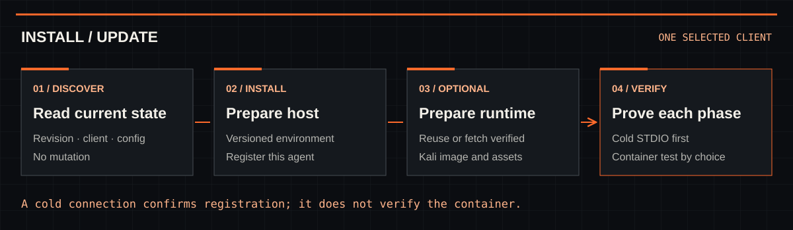
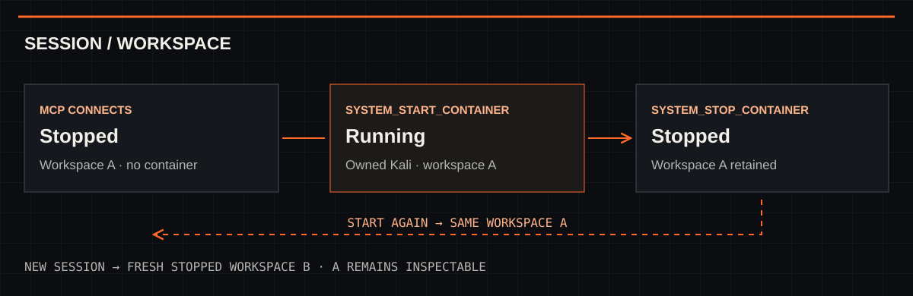

<p align="center"></p>

<h1 align="center">Hercules MCP</h1>
<p align="center"><strong>A Kali workspace for your AI agent.</strong></p>
<p align="center"><a href="https://0xmihirk.github.io/hercules-mcp/">Explore the website</a> · <a href="install.md">Install or update</a> · <a href="GUIDE.md">Detailed guide</a></p>

Hercules connects terminal-capable AI agents to structured security tools and an explicitly started, session-owned Kali container. The host workspace retains evidence after the container stops. Tools return bounded results and report when output or evidence is incomplete.

> **Authorized use only.** Use Hercules only on systems you are permitted to test. A full Kali image and privileged shell are powerful; Docker does not supply target authorization.


## Install with your AI agent

Paste this prompt into the terminal-capable agent you want to configure:

```text
Install or update Hercules MCP using https://github.com/0xMihirK/hercules-mcp/blob/main/install.md. Configure only this agent. Host install needs no container; if a container step is denied, stop and tell me how to approve it. Report the result.
```

The [setup guide](install.md) covers supported clients, Windows/macOS/Linux bootstrap commands, repair, updates, recovery, and Claude Code auto mode. Host installation does not start Docker. Runtime preparation and container verification are separate, explicit steps. Existing client settings, secrets, workspaces, and evidence are preserved during an update; an incompatible replacement stays pending while the working version remains active.



## From request to retained evidence

Connecting an MCP client exposes tools and resources without creating a container. Call `system_start_container` before the first Docker-backed operation. Repeated starts reuse the same owned container; `system_stop_container` stops it while retaining its workspace. `system_start_new_session` creates a fresh, stopped workspace. `workspace_inspect` can read current or retained owned evidence without Docker.



| What the agent needs | Where to begin |
| --- | --- |
| Network and service discovery | `recon_dns`, `nmap_scan`, `network_curl` |
| Web and browser testing | `fuzz_dirs`, `nuclei_run`, `browser_open`, `browser_snapshot` |
| Exploit and version research | `searchsploit`, optional Metasploit, and current vendor/CVE sources through the agent’s own search |
| Files, binary triage, and custom tools | `workspace_inspect`, Binwalk, `shell_exec` |
| Evidence and cleanup | Workspace read/write tools, jobs, `system_stop_container` |

The full profile exposes **47 tools, 5 resources, and 2 lookup templates**. Disabling Metasploit exposes 42 tools; core-only exposes 12. One image contains the tool bundles; capability choices change MCP visibility, not installed packages. The plugin also ships [nine focused skills](skills/hercules-mcp/SKILL.md), including operator guidance, NSE and Nuclei authoring, and domain references.

## Important limits

- Hercules does not enforce a target allowlist. Structured tools check target syntax, and the host-network browser has **no SSRF boundary**. Keep every operation within your authorized scope.
- Obscura **does not enforce CSP** and does not support native browser downloads. Use HTTP or shell workflows for authorized downloads, then verify the saved file. Browser behavior is not proof of Chromium-equivalent behavior.
- `shell_exec` and advanced browser commands can bypass structured-tool safeguards. Container-layer tool installs are temporary; keep scripts, virtual environments, and dependency notes in the workspace.
- Output can be filtered or paged. Preserve complete diagnostics and check `output_complete`, `evidence_complete`, and cleanup confirmation before drawing conclusions.

For configuration, security details, workspace migration, troubleshooting, and development checks, use the [detailed guide](GUIDE.md). For the exact setup workflow, use [install.md](install.md).

## License

[MIT](LICENSE). Built with Kali Linux, FastMCP, Metasploit, ProjectDiscovery tools, agent-browser, and Obscura; see the [acknowledgements](GUIDE.md#acknowledgements).

## Support

If Hercules has helped your work, [buy me a beer](https://buymeacoffee.com/mihirkatoch) to support its continued development.
